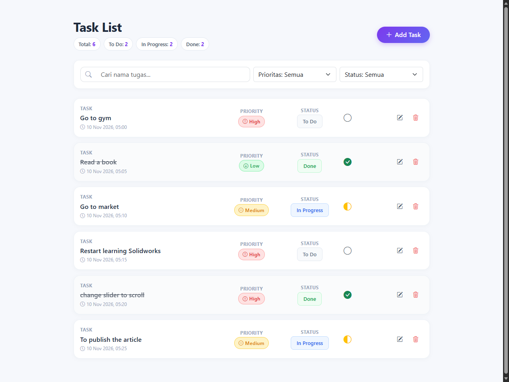
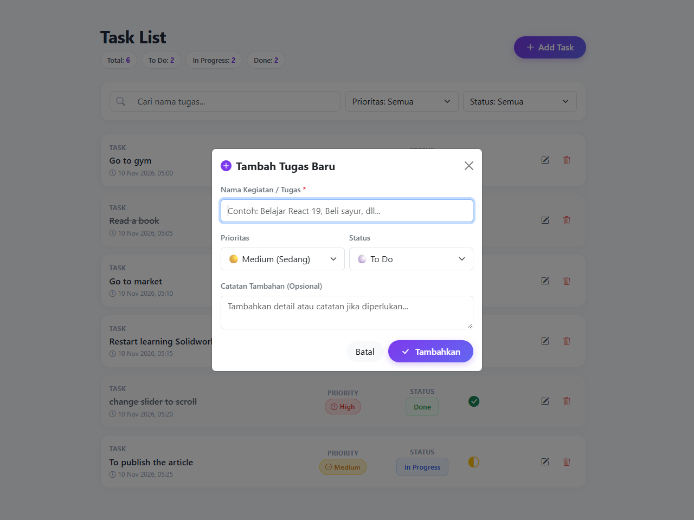

# 📝 TodoList CRUD Application (React 19 & Bootstrap)

> **Tugas Praktikum Pemrograman Frontend / Framework**  
> Aplikasi manajemen tugas (TodoList) berbasis **React JS (React 19)** dan **Bootstrap 5** dengan fitur CRUD lengkap serta kustomisasi antarmuka modern yang ditingkatkan.

---

## 📸 Tangkapan Layar (Screenshots)

### 1. Tampilan Antarmuka Utama (Task List)


### 2. Form Tambah & Edit Tugas (Modal)


---

## ✨ Fitur-Fitur Utama

Sesuai dengan ketentuan tugas praktikum:

1. **Operasi CRUD Lengkap**:
   - **Create**: Menambahkan tugas baru melalui modal dialog interaktif dengan validasi input.
   - **Read**: Menampilkan daftar tugas secara rapi dengan tata letak card modern.
   - **Update**: Mengedit nama tugas, prioritas, status, serta catatan tambahan.
   - **Delete**: Menghapus tugas dengan modal konfirmasi pengamanan.

2. **Lencana (Badge) Warna pada Priority**:
   - 🔴 **High**: Lencana warna **Merah** (`badge-priority-high`).
   - 🟡 **Medium**: Lencana warna **Kuning** (`badge-priority-medium`).
   - 🟢 **Low**: Lencana warna **Hijau** (`badge-priority-low`).

3. **Indikator Status Visual & Interaktif**:
   - Lencana status teks (`To Do`, `In Progress`, `Done`).
   - Indikator ikon status visual:
     - ⚪ **To Do**: Lingkaran kosong (`bi-circle`).
     - 🟡 **In Progress**: Setengah lingkaran (`bi-circle-half`).
     - 🟢 **Done**: Centang penuh (`bi-check-circle-fill`).
   - **Fitur Interaktif**: Ikon status dapat diklik langsung untuk mengubah alur tugas secara cepat (*To Do* ➔ *In Progress* ➔ *Done* ➔ *To Do*).

4. **Ikon Tombol Aksi**:
   - ✏️ **Edit**: Ikon pena/pensil (`bi-pencil-square`) dengan efek sorot tombol.
   - 🗑️ **Delete**: Ikon tempat sampah merah (`bi-trash3`) dengan konfirmasi penghapusan.

5. **Kustomisasi & Peningkatan Fitur Tambahan (Sesuai Catatan b Tugas)**:
   - 🔍 **Filter Pencarian Real-Time**: Mencari tugas secara cepat berdasarkan kata kunci.
   - 🎯 **Filter Kategori**: Menyaring tugas berdasarkan tingkat Prioritas dan Status.
   - ⏰ **Waktu Pembuatan Tugas (Timestamp)**: Menampilkan tanggal dan jam saat tugas dibuat.
   - 💾 **Penyimpanan Lokal (LocalStorage)**: Data tugas tersimpan otomatis di browser sehingga tidak hilang saat halaman direfresh.
   - 📊 **Statistik Ringkasan Tugas**: Kartu ringkasan jumlah tugas (Total, To Do, In Progress, Done).
   - 🔔 **Notifikasi Toast**: Umpan balik visual interaktif setiap kali data berhasil ditambahkan, diubah, atau dihapus.

---

## 🛠️ Teknologi yang Digunakan

- **React JS** `v19.3.1` (Frontend Library)
- **Vite** `v8.3.6` (Next Generation Build Tool)
- **Bootstrap** `v5.3.8` (CSS Framework)
- **React-Bootstrap** `v2.10.10` (Komponen UI Bootstrap untuk React)
- **Bootstrap Icons** `v1.11.3` (Ikonografi UI)

---

## 📁 Struktur Direktori

```text
react-todolist-crud/
├── public/                 # Aset publik statis
├── screenshots/            # Tangkapan layar tampilan aplikasi
│   ├── preview.png         # Screenshot antarmuka utama
│   └── modal_preview.png   # Screenshot modal form
├── src/
│   ├── assets/
│   │   ├── TaskForm.jsx    # Komponen Form Tambah & Edit Tugas (Modal)
│   │   └── TaskList.jsx    # Komponen Daftar Tugas & Item Card
│   ├── App.css             # Kustomisasi CSS tata letak modern
│   ├── App.jsx             # Komponen Utama, State CRUD & Filter
│   ├── index.css           # Styling dasar
│   └── main.jsx            # Entry point aplikasi & inisialisasi Bootstrap
├── index.html              # HTML template
├── package.json            # Daftar dependensi & scripts
├── vite.config.js          # Konfigurasi Vite
└── README.md               # Dokumentasi proyek
```

---

## 🚀 Panduan Menjalankan Proyek di Komputer Lokal

### 1. Prasyarat
Pastikan Anda telah menginstal **Node.js** (versi 18 ke atas) dan **npm**.

### 2. Langkah Menjalankan
Buka terminal pada folder proyek ini, lalu jalankan:

```bash
# 1. Pindah ke direktori proyek (jika belum berada di dalamnya)
cd react-todolist-crud

# 2. Instal seluruh dependensi
npm install

# 3. Jalankan development server
npm run dev
```

Buka browser dan akses alamat yang ditampilkan pada terminal (biasanya `http://localhost:5173/`).

---

